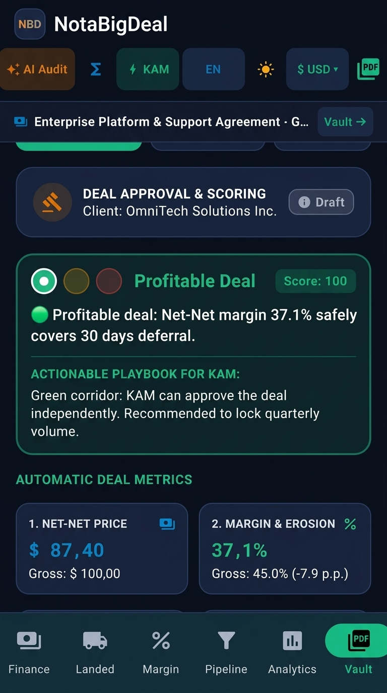
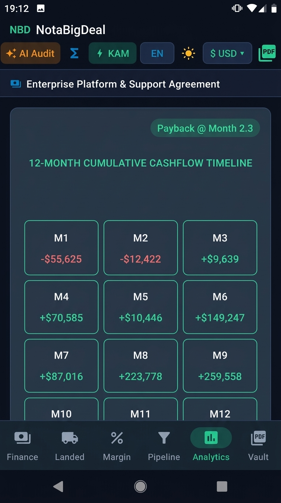
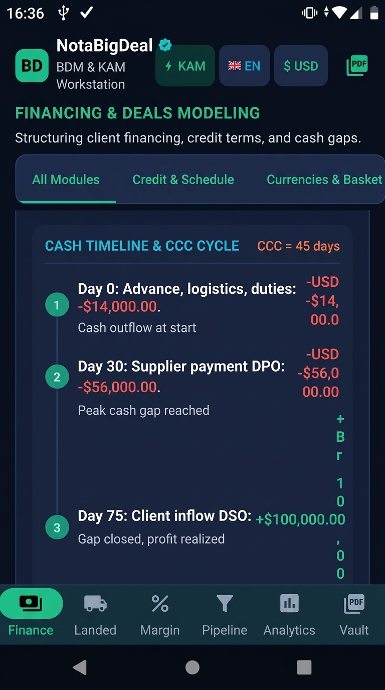

# NotaBigDeal — Enterprise B2B Pricing Engine, Deal Desk & Negotiation Workstation

[-green.svg)](https://developer.android.com)
[](https://kotlinlang.org)
[](https://developer.android.com/jetpack/compose)
[-brightgreen.svg)]()
[]()
[]()
[]()

[🇬🇧 English](README.md) | [🇷🇺 Читать на русском](README_RU.md)

> **Eliminate margin leakage at the negotiation table.** NotaBigDeal is an offline-first, executive-grade financial calculation engine, pricing governance desk, and deal-structuring platform designed for Key Account Managers (KAMs), Commercial Directors, and CFOs. Structure Net-Net retail price waterfalls, balance buyer concessions with compensatory "Give-Get" trades, model working capital (NWC) and invoice factoring arbitrage, stress-test EBITDA with McKinsey Tornado charts, and export boardroom-ready 2-page PDF proposals directly from your Android smartphone — without laptops, spreadsheets, or broken formulas.

---

## Visual Overview

<p align="center">
  
  
  
</p>

---

## Why NotaBigDeal?

During high-stakes commercial negotiations with retail supermarket chains and enterprise enterprise procurement committees, million-dollar margin commitments are made in minutes. When a buyer demands:
* an extra **+45 days payment deferral**;
* an additional **5% on-invoice front discount**; and
* an **8.5% off-invoice retro-rebate** with listing fees;

a commercial leader needs answers within seconds:
1. **True Pocket Net-Net Margin**: What remains after all layered discounts, rebates, logistics charges, and SLA fines?
2. **Working Capital & Carrying Cost**: How much cash is frozen in accounts receivable ($AR$), and does invoice factoring beat bank overdraft?
3. **Required Counter-Trades ("Give-Get")**: Exactly how much volume lift or price adjustment must be demanded in return so corporate EBITDA is not destroyed?
4. **Profit Sensitivity Leverage**: Is it safer to concede on price or volume? (The McKinsey model proves price defense is typically $2\text{x}$–$4\text{x}$ more powerful than chasing volume).

**NotaBigDeal** packages Wall Street financial modeling into an ergonomic, tactile, and responsive mobile app built with Jetpack Compose.

---

## Core Feature Modules & Financial Engines

```
┌──────────────────────────────────────────────────────────────────────────────────────────────────┐
│                                   NotaBigDeal Core Architecture                                  │
├───────────────────────────────┬──────────────────────────────────┬───────────────────────────────┤
│    COMMERCIAL PRICING DESK    │    FINANCING & WORKING CAPITAL   │    GOVERNANCE & ANALYTICS     │
│  • Retail Price Waterfall     │  • Net Working Capital (NWC)     │  • 2-Page Boardroom PDF       │
│  • Give-Get Concession Engine │  • Cash Conversion Cycle (CCC)   │  • Deal Scoring Traffic Light │
│  • Tornado Profit Sensitivity │  • Invoice Factoring Arbitrage   │  • Gemini 3.8 Flash AI Audit  │
│  • Promo Break-Even Solver    │  • 2-Tier Grace Amortization     │  • Offline Formula Glossary   │
│  • Landed Cost (FOB ➔ Whs)    │  • Multi-Currency Credit Basket  │  • Cloud Vault (Firestore)    │
└───────────────────────────────┴──────────────────────────────────┴───────────────────────────────┘
```

### 1. Retail Price Waterfall & Net-Net Pocket Margin Engine
Deconstructs transactions from consumer shelf RSP down to supplier pocket cash:
- **Shelf Price (RSP)** with VAT and Ex-VAT baseline;
- **Retailer Margin Deduction**: Gross margin taken by the supermarket chain;
- **On-Invoice Front Discount**: Base wholesale invoice price;
- **Off-Invoice Deductions**: Performance retro-rebates, annual bonuses, slotting allowances, and DC logistics delivery costs;
- **Net-Net Realized Price & True Contribution Margin %**: Exact bottom-line cash retained by the vendor.

### 2. "Give-Get" Concession Balancing Engine (EBITDA Guard — P1)
Protects vendor profitability by transforming one-sided concessions into balanced counter-trades:
- **The Give (Buyer Concession Request)**:
  - Payment Deferral (+Days);
  - Extra Price Discount (+%);
  - Increased Retro-Rebate (+%);
  - Free Logistics / Delivery Absorption;
  - Marketing / Slotting Fee.
- **Monetary Damage Quantification**: Calculates direct cash cost and margin erosion in percentage points.
- **The 4 Compensatory Gets (Keeping Deals EBITDA-Neutral)**:
  1. **Contracted Volume Lift**: Minimum units and percentage surge required so unit contribution margin absorbs the concession;
  2. **Base Price Indexation**: Required price list adjustment if volume remains fixed;
  3. **Rebate Clawback**: Offsetting deduction from quarterly marketing or promotional funds;
  4. **Payment Acceleration**: Upfront cash prepayment requirement to eliminate working capital carry cost.
- **Instant KAM Negotiation Script**: Generates a professional negotiation talk track in English and Russian with 1-tap clipboard copying.

### 3. Net Working Capital (NWC), Cash Conversion Cycle & Factoring Arbitrage (P2)
A dedicated treasury and working capital suite for enterprise contracts:
- **Cash Conversion Cycle (CCC)**: Tracks cash flow velocity across days:
  $$CCC = DSO + DIO - DPO$$
- **Net Working Capital (NWC) Decomposition**:
  $$AR = \text{Revenue} \times \frac{DSO}{365}, \quad Inv = \text{COGS} \times \frac{DIO}{365}, \quad AP = \text{COGS} \times \frac{DPO}{365}$$
  $$NWC = AR + Inv - AP$$
- **Invoice Factoring Engine**:
  - Advance Rate % (presets for 80%, 85%, 90%);
  - Factoring Service Fee % and annual factoring discount rate %;
  - Calculates immediate Day-0 cash inflow, total factoring cost, and Effective APR %;
  - **Required Price Uplift**: Calculates the exact compensatory markup (+% to contract price) needed to neutralize factoring costs.
- **Financial Arbitrage Verdict (Factoring vs Overdraft)**:
  - Compares total factoring fees against revolving bank credit lines;
  - Highlights winning strategy badge (*"Factoring Saves $X vs Bank Overdraft! Instant Liquidity"* or *"Bank Overdraft is Cheaper by $Y"*);
  - Strategic guidance for negotiating when bank credit lines are constrained.

### 4. Tornado Sensitivity & Profit Leverage Chart (McKinsey / DuPont — P4)
Evaluates contract EBITDA vulnerability to independent shifts ($\pm 5\%$ and $\pm 10\%$) in 5 operational drivers:
- **DuPont Profit Leverage Multipliers**: Quantifies the percentage shift in EBITDA resulting from a 1% independent variation in Selling Price ($P$), Sales Volume ($Q$), Direct COGS ($C$), Operating Expenses ($F$), and Rebates ($D$);
- **Interactive Bilateral Tornado Chart**: Center-aligned baseline EBITDA bar chart showing upside/downside ranges sorted in descending order of sensitivity;
- **Price vs Volume Leverage Ratio**: Proves mathematically why defending shelf price is typically $2.0\text{x}$–$4.0\text{x}$ more powerful than pursuing volume concessions;
- **Expandable KAM Negotiation Playbook**: Strategic rules for countering buyer price-slashing tactics.

### 5. Commercial Financing, Two-Tier Grace Period & Debt Prolongation
Structures capital equipment leasing, vendor financing, and structured installments:
- **5 Payment Frequencies**: Weekly (52/yr), Bi-Weekly (26/yr), Monthly (12/yr), Quarterly (4/yr), and Annually (1/yr);
- **Two-Tier Grace Period Amortization**:
  - Subsidized or 0% interest rate during moratorium periods ($1 \dots N_{grace}$);
  - Standard annuity amortization over the remaining tenure ($N_{grace}+1 \dots N_{total}$);
- **Credit Prolongation Analyzer**: Evaluates month-to-month and week-to-week term extensions, contrasting installment relief (-47%) against total interest inflation (+96%);
- **Multi-Currency Debt Basket**: Distributes principal across up to 4 currencies (USD, EUR, CNY, RUB, etc.) with forward currency hedging adjustments.

### 6. Deal Approval Desk & Traffic Light Governance Corridor (BATNA)
Automated commercial governance before signatures are exchanged:
- 🟢 **Profitable Deal**: Healthy Net-Net margin exceeding corporate WACC/hurdle rates. Eligible for KAM self-approval;
- 🟡 **Borderline Deal**: Margin compressed by rebates or prolonged deferral (>45 days). Commercial Director review required with mandatory counter-trades;
- 🔴 **Margin Destroyer**: Below unit cost or financing charge turns deal toxic. Automated sign-off freeze with CFO escalation;
- **BATNA Corridor**: 1-click presets for Target, Compromise, and Walk-Away boundaries.

### 7. Import Landed Cost & Incoterms Modeler (FOB ➔ Warehouse)
Converts factory pricing into landed domestic warehouse cost:
- Coefficient multipliers ($K \approx 1.28$ to $1.75$) incorporating freight, customs tariffs, broker fees, and import VAT;
- Built-in trade profiles for major hubs: China, Turkey, UAE, European Union, India, and EAEU;
- **Reverse Solver**: Derives maximum allowable FOB factory purchase price from a target domestic landed cost budget.

### 8. Promo Break-Even & Elasticity Lift Solver
Answers the fundamental retail promotion question: *«By what percentage must sales volume increase under a discount of $d\%$, so company gross profit does not decrease?»*
$$\text{Volume Lift}\% = \frac{d\%}{\text{Gross Margin}\% - d\%} \times 100\%$$
Includes feasibility flags to prevent sales teams from signing margin-negative promotions.

### 9. Retail SLA Penalty & Fill-Rate Sensitivity
Simulates net pocket margin after supermarket logistics deductions:
- Calculates underdelivery fines based on planned vs actual order Fill-Rate (80%–100%);
- Models time-slot arrival penalties and pallet quantum non-compliance;
- Exposes actual "Pocket Margin" versus theoretical contract margin.

### 10. Client Negotiation History & Account CRM (Vault)
Enterprise counterparty database with multi-device cloud synchronization:
- Tracks agreed discount caps, volume tiers, payment deferrals, and currency settings;
- Historical contract log and chronological multi-round negotiation ledger;
- 1-click **"Apply Client Terms"** workflow into active deal calculations;
- Full CRUD operations with Firestore cloud backup.

### 11. Boardroom 2-Page Vector PDF Deal Proposal & LinkedIn Product Flyer
Generates publication-quality vector PDF documents on-device via native `android.graphics.pdf.PdfDocument`:
- **Page 1: Commercial Deal Desk Brief**:
  - Executive header with deal ID, counterparty, and currency;
  - 4-Pillar KPI Cards (Contract Value, Margin %, Payback, LTV:CAC);
  - Deal Approval & Scoring traffic light;
  - Give-Get Concession Balancing breakdown;
  - Tornado Sensitivity table;
  - Retail Price Waterfall cascade.
- **Page 2: Financial Underwriting & Projections**:
  - Financing terms & repayment schedule with Grace Period indicators;
  - Net Working Capital (NWC), Cash Conversion Cycle, and Factoring vs Overdraft summary;
  - Full Contract P&L Statement (Revenue, COGS, Gross Profit, OPEX, EBITDA);
  - Unit Economics & LTV/CAC cohort metrics;
  - Import Landed Cost analysis;
  - 3-signature executive sign-off block (Commercial Director, Head of Legal, CFO).
- **LinkedIn Product Flyer (PDF)**: High-impact executive one-pager showcasing core modules, UI highlights, and CFO ROI metrics for LinkedIn outreach.

### 12. Dual-Core AI Deal Risk Express Audit
1-tap deal audit button on the top toolbar:
- **Cloud Engine**: Google Gemini 3.8 Flash via Firebase AI Logic;
- **Deterministic Offline Engine (0ms)**: Instant heuristic financial audit providing 100% uptime in basements, flights, or air-gapped meeting rooms;
- **Structured 3-Thesis Output**: Margin traps, Working capital risk, KAM counter-offer playbook;
- **Zero-Failure Guarantee**: Automatically falls back to local engine if network fails.

---

## Technical Architecture & Code Quality

```
com.example
├── data
│   ├── ai           # AI Deal Risk Auditor (Firebase AI Logic + 0ms Offline Heuristics)
│   ├── model        # Immutable Kotlin Data Models (SavedDeal, Amortization, LandedCost)
│   └── repository   # AuthRepository & DealRepository (Firestore + Cache + Credential Manager)
├── domain
│   ├── calculator   # Pure Domain Math Engines (CashGap, GiveGet, Tornado, Waterfall, PnL)
│   └── model        # Financial Formula Glossary (Offline Definitions & KAM Tips)
├── service          # Android Native PdfExportService (2-Page Vector A4 PDF & Flyer)
└── ui
    ├── components   # Modular Material 3 Cards (Tornado, GiveGet, CashGap, Waterfall)
    ├── screens      # 6 Root Screens (Margin, Financing, Pipeline, Landed, Vault, Analytics)
    ├── theme        # Obsidian Executive Dark & Nordic Light Slate (Dynamic Tokens)
    └── viewmodel    # BigDealViewModel (Reactive StateFlow & Coroutines)
```

- **Clean Architecture & MVVM**: Unidirectional data flow with pure mathematical engines in `domain/calculator/` completely decoupled from Android framework dependencies;
- **Material Design 3 (M3) Dual-Theming**:
  - **Obsidian Executive Dark**: Deep midnight palette (`#0B101D`) with emerald accents (`#10B981`) designed to reduce visual fatigue during evening sessions;
  - **Nordic Light Slate**: Soft glare-free paper palette (`#F4F6F9`) with crisp slate typography (`#0F172A`) for boardroom projectors and daylight;
- **Zero Third-Party PDF Bloat**: Native Android vector canvas rendering with zero external PDF dependencies, zero memory leaks, and native `ACTION_SEND` intent sharing;
- **Comprehensive Unit Testing**: 48 unit tests verifying financial math, amortization schedules, Tornado sensitivities, and factoring arbitrage.

---

## Installation & Build

### Prerequisites
- Android Studio Ladybug / Meerkat or newer;
- JDK 17+;
- Android SDK 26+ (compiled for SDK 36).

### Clone & Build
```bash
git clone https://github.com/your-username/notabigdeal.git
cd notabigdeal
gradle assembleDebug
```

### Running Automated Verification Tests
Execute the test suite verifying all financial algorithms, rounding guards, and edge cases:
```bash
gradle :app:testDebugUnitTest
```
*(48 unit tests, 100% passing)*.

---

## Author & Contact

Developed for commercial directors, enterprise Key Account Managers, and financial analysts.

- **LinkedIn**: [www.linkedin.com/in/snitkor](https://www.linkedin.com/in/snitkor)
- **App Name**: **NotaBigDeal**
- **License**: Proprietary / Enterprise Confidential
