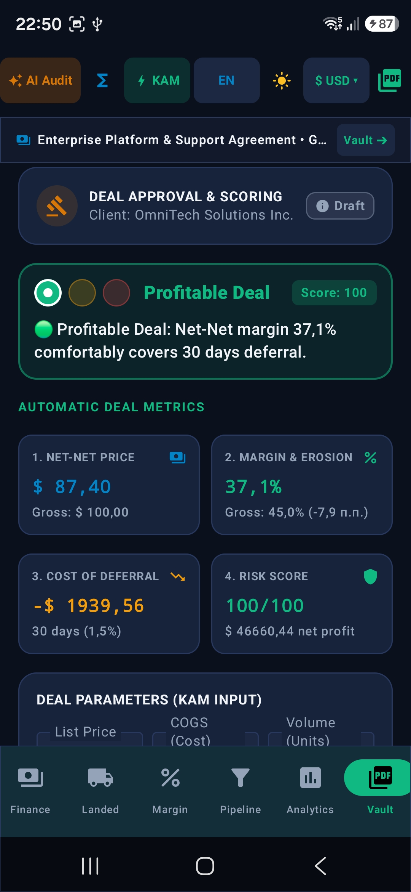
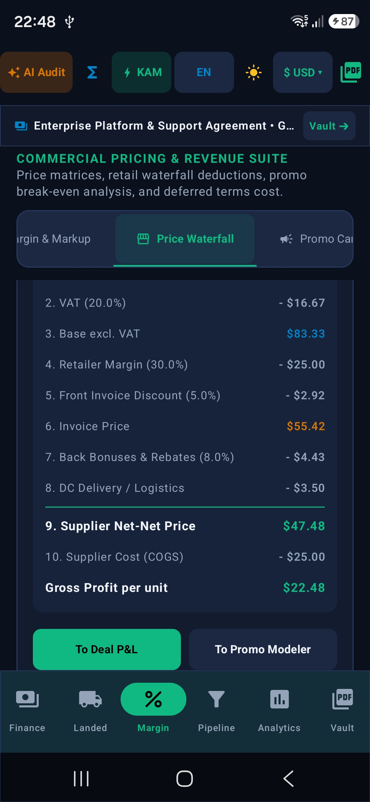
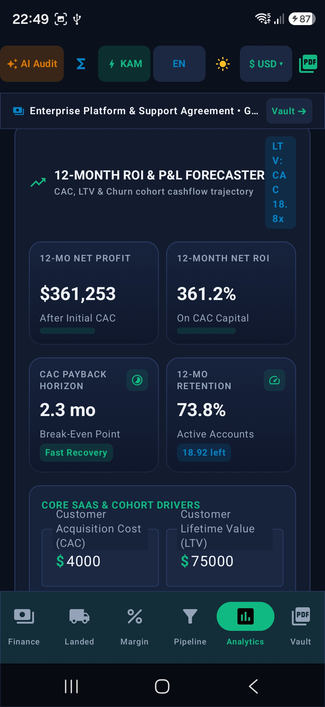
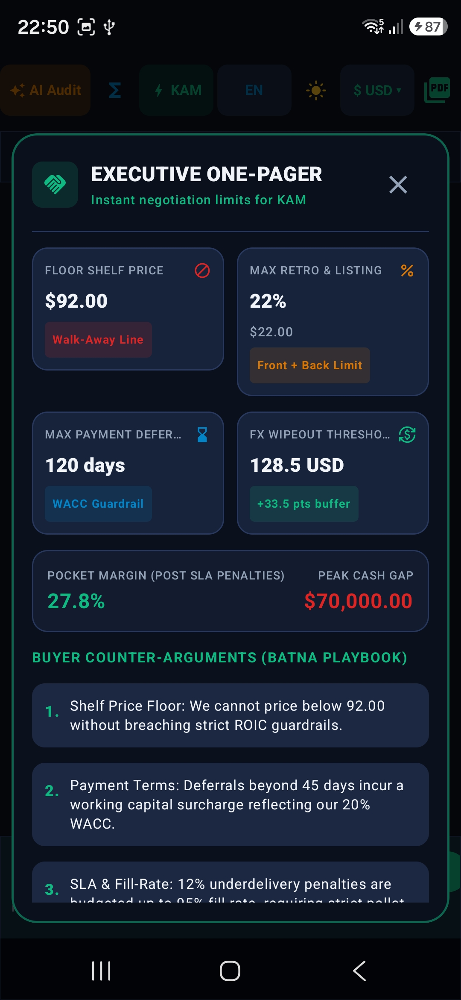

# NotaBigDeal — Мобильный калькулятор и помощник для коммерческих переговоров (Commercial Deal Intelligence Platform)

[-green.svg)](https://developer.android.com)
[](https://kotlinlang.org)
[](https://developer.android.com/jetpack/compose)
[-brightgreen.svg)]()
[]()
[]()
[]()

[🇬🇧 Read in English](README.md) | [🇷🇺 Русский](README_RU.md)

> **Остановите утечку маржи за столом переговоров.** NotaBigDeal — это автономная (offline-first) финансово-аналитическая платформа и переговорный пульт для Key Account Managers (КАМ), коммерческих директоров и CFO. Рассчитывайте цепочки Net-Net цен, защищайте прибыль встречными требованиями в движке «Give-Get», моделируйте чистый оборотный капитал (NWC) и арбитраж факторинга против овердрафта, оценивайте устойчивость EBITDA диаграммами чувствительности Торнадо (McKinsey) и создавайте двухстраничные PDF-предложения уровня совета директоров прямо со смартфона — без ноутбуков и тяжелых таблиц Excel.

---

## Визуальный интерфейс

<p align="center">
  
  
  
  
</p>

---

## Зачем нужен NotaBigDeal?

В B2B-переговорах с федеральными сетями и крупными корпоративными клиентами решения на миллионы принимаются за считанные минуты. Когда байер на переговорах жестко требует:
* дополнительную **отсрочку платежа +45 дней**;
* добавочную **скидку 5% в накладной**; и
* **ретро-бонус 8.5%** с компенсацией логистики;

коммерческому лидеру нужны точные ответы прямо сейчас:
1. **Реальная карманная маржа (Net-Net Pocket Margin)**: сколько чистых денег останется в кассе компании после всех скидок, бонусов, логистики и штрафов SLA?
2. **Заморозка оборотного капитала (NWC)**: сколько ликвидности вымоет отсрочка, и что выгоднее — отдать инвойс на факторинг или закрывать разрыв банковским овердрафтом?
3. **Встречные требования (Движок «Give-Get»)**: какой минимальный прирост объема (+X шт. / +Y%) или компенсацию в цене нужно потребовать взамен, чтобы сделка не уничтожила EBITDA?
4. **Рычаги чувствительности (Диаграмма Торнадо)**: что опаснее уступать — цену или объем? (Модель McKinsey доказывает: защита цены в $2\text{x}$–$4\text{x}$ эффективнее погони за объемами).

**NotaBigDeal** переносит строгую математику инвестиционного банкинга в тактильный и удобный мобильный интерфейс Jetpack Compose.

---

## Ключевые модули и финансовые движки

```
┌──────────────────────────────────────────────────────────────────────────────────────────────────┐
│                                 Архитектура модулей NotaBigDeal                                  │
├───────────────────────────────┬──────────────────────────────────┬───────────────────────────────┤
│      КОММЕРЧЕСКИЙ ДЕСК        │    ФИНАНСИРОВАНИЕ И КАПИТАЛ      │    УПРАВЛЕНИЕ И АНАЛИТИКА     │
│  • Ценовой водопад Net-Net    │  • Чистый оборотный капитал NWC  │  • 2-страничный PDF для СД    │
│  • Размен уступок (Give-Get)  │  • Финансовый цикл (CCC)         │  • Светофор Deal Scoring      │
│  • Диаграмма Торнадо (McKinsey│  • Арбитраж факторинга           │  • Экспресс AI-аудит (Gemini) │
│  • Безубыточность промо       │  • Грейс-период (Grace Period)   │  • Офлайн-справочник формул   │
│  • Себестоимость FOB ➔ Склад  │  • Мультивалютный синдикат       │  • Облачный Deal Vault        │
└───────────────────────────────┴──────────────────────────────────┴───────────────────────────────┘
```

### 1. Ценовой водопад ритейла и карманная маржа (Price Waterfall & Net-Net)
Пошаговая декомпозиция цепочки от цены на полке магазина до чистой выручки поставщика:
- **Полочная цена (РРЦ)** с НДС и база без НДС;
- **Маржа ритейлера**: торговая наценка торговой сети;
- **Фронт-скидка в накладной**: оптовая цена поставки;
- **Бэк-бонусы и вычеты**: прогрессивный ретро-бонус, маркетинговые соглашения, плата за листинг и доставка до РЦ;
- **Net-Net цена поставщика и фактическая маржинальность сделки %**: реальный остаток чистых денег после всех удержаний.

### 2. Движок размена уступок (Give-Get Concession Balancing Engine — P1)
Защищает маржу компании от одностороннего «продавливания» байером:
- **Требования закупщика («The Give»)**:
  - Дополнительная отсрочка (+дней);
  - Добавочная скидка (+%);
  - Увеличение ретро-бонуса (+%);
  - Бесплатная доставка / логистика за счет поставщика;
  - Плата за полку / маркетинговый вход.
- **Оценка финансового ущерба**: прямой убыток в деньгах и срез чистой маржи в процентных пунктах.
- **4 компенсационных встречных условия («The Gets»)** для сохранения плановой EBITDA:
  1. **Прирост контрактного объема (Volume Lift)**: расчет минимального числа дополнительных единиц, прибыль от которых окупает уступку;
  2. **Индексация базовой цены**: процент повышения прайс-листа при сохранении объема;
  3. **Срез ретро-бонусов**: эквивалентное сокращение квартальной маркетинговой премии;
  4. **Авансирование / ускорение оплаты**: требование предоплаты для ликвидации затрат на оборотный капитал.
- **Речевой скрипт КАМа**: готовый переговорный модуль на русском и английском языках с копированием в буфер обмена в 1 клик.

### 3. Чистый оборотный капитал (NWC), цикл CCC и арбитраж факторинга (P2)
Казначейский модуль управления ликвидностью контракта:
- **Финансовый цикл обращения денег (Cash Conversion Cycle)**:
  $$CCC = DSO + DIO - DPO$$
- **Раскладка чистого оборотного капитала (NWC)**:
  $$AR = \text{Выручка} \times \frac{DSO}{365}, \quad Inv = \text{COGS} \times \frac{DIO}{365}, \quad AP = \text{COGS} \times \frac{DPO}{365}$$
  $$NWC = AR + Inv - AP$$
- **Калькулятор факторинга инвойсов**:
  - Размер аванса (80%, 85%, 90%);
  - Комиссия фактора и процентная ставка за период отсрочки;
  - Мгновенный расчет суммы финансирования в день отгрузки, совокупных затрат и эффективной ставки APR %;
  - **Компенсационная наценка (Price Uplift %)**: на сколько процентов поднять базовую цену сети, чтобы полностью переложить расходы на факторинг на покупателя.
- **Финансовый арбитраж («Факторинг vs Овердрафт»)**:
  - Сопоставление расходов факторинга с банковским овердрафтом;
  - Бейдж победителя стратегии (*«Факторинг выгоднее на $X! Деньги на день 0 без залогов»* либо *«Овердрафт дешевле на $Y»*);
  - Переговорные рекомендации для КАМа при исчерпании банковских лимитов.

### 4. Диаграмма чувствительности прибыли Торнадо (McKinsey / DuPont — P4)
Оценка уязвимости EBITDA контракта к колебаниям ключевых факторов на $\pm 5\%$ и $\pm 10\%$:
- **Операционные мультипликаторы DuPont**: процентное изменение прибыли EBITDA при сдвиге на 1% Цены ($P$), Объема ($Q$), Себестоимости ($C$), Накладных расходов ($F$) и Скидок ($D$);
- **Интерактивная двусторонняя диаграмма Торнадо**: ранжирование факторов от наиболее рискованного к наименее чувствительному;
- **Соотношение чувствительности «Цена vs Объем»**: математическое доказательство того, почему удержание цены в 2–4 раза важнее погони за валовым объемом;
- **Шпаргалка переговоров КАМа**: тактические правила парирования скидочных требований закупщика.

### 5. Контрактное финансирование, двухступенчатый грейс-период и пролонгация
Моделирование рассрочек, лизинга оборудования и проектного кредитования:
- **5 вариантов периодичности**: еженедельно (52/год), раз в 2 недели (26/год), ежемесячно (12/год), ежеквартально (4/год), ежегодно (1/год);
- **Двухступенчатая ставка с льготным периодом (Grace Period)**:
  - Мораторий или субсидированная ставка в период льготы ($1 \dots N_{grace}$);
  - Равная аннуитетная амортизация остатка долга после льготы ($N_{grace}+1 \dots N_{total}$);
- **Анализ пролонгации кредита**: точное сопоставление кассового облегчения ежемесячного платежа (-47%) с итоговым ростом процентной переплаты (+96%);
- **Мультивалютный кредитный портфель**: разделение займа на 4 валюты (USD, EUR, CNY, RUB) с расчетом стоимости валютного хеджа.

### 6. Согласование сделки (Deal Approval) и Светофор рисков (BATNA)
Автоматизированный коммерческий контроль перед подписанием контракта:
- 🟢 **Прибыльная сделка**: чистая маржа выше барьерной ставки WACC, безопасная отсрочка. Автоматическое согласование КАМом;
- 🟡 **Пограничная сделка**: маржа сжата бонусами или отсрочка >45 дней. Требуется утверждение коммерческого директора с встречными условиями;
- 🔴 **Уничтожает прибыль**: цена ниже себестоимости либо проценты съедают маржу. Блокировка и эскалация CFO;
- **Коридор BATNA**: сценарии Target, Compromise и Walk-Away (красная черта ухода со стола).

### 7. Себестоимость импорта (Landed Cost FOB ➔ Склад)
Расчет реальной себестоимости товара на складе с учетом логистики и таможни:
- Коэффициенты удорожания ($K \approx 1.28$ – $1.75$) с учетом пошлин, фрахта, брокерских сборов и ввозного НДС;
- Предустановленные торговые профили: Китай, Турция, ОАЭ, ЕС, Индия, ЕАЭС;
- **Реверсивный расчет**: вычисление предельно допустимой закупочной цены FOB завода под заданный бюджет себестоимости.

### 8. Промо-акции и порог безубыточности (Promo Break-Even)
Отвечает на фундаментальный вопрос акций: *«На сколько процентов должен вырасти объем продаж при скидке $d\%$, чтобы валовая прибыль компании не упала?»*
$$\text{Прирост объема}\% = \frac{d\%}{\text{Маржа}\% - d\%} \times 100\%$$
Индикаторы выполнимости защищают отдел продаж от запуска убыточных промо-акций.

### 9. Штрафы торговых сетей и карманная маржа (SLA Penalty)
Моделирование реального дохода после логистических штрафов ритейлера:
- Штрафы за срыв уровня сервиса (Fill-Rate 80%–100%);
- Неустойки за опоздание в тайм-слот разгрузки на РЦ и кванты паллет;
- Расчет «карманной маржи» (Pocket Margin) против номинальной на бумаге.

### 10. Хранилище сделок и профили клиентов (Deal Vault CRM)
База контрагентов с облачной синхронизацией:
- Фиксация согласованных отсрочек, кредитных лимитов, потолков скидок и ступеней бонусов;
- Хронологический журнал раундов переговоров;
- 1-клик перенос условий клиента в активный расчет новой сделки;
- Надежное сохранение в облаке Google Firestore.

### 11. Двухстраничный представительский PDF-отчет и листовка для LinkedIn
Векторная генерация документов на устройстве через нативный `android.graphics.pdf.PdfDocument`:
- **Страница 1: Коммерческий бриф сделки**:
  - Шапка с ID сделки, датой и валютой;
  - 4 ключевых KPI (Сумма контракта, Маржа %, Срок окупаемости, LTV:CAC);
  - Светофор скоринга Deal Approval;
  - Баланс уступок Give-Get;
  - Таблица чувствительности Торнадо;
  - Ценовой водопад Net-Net.
- **Страница 2: Финансовое андеррайтинг-моделирование**:
  - График платежей и амортизации с отметками Grace Period;
  - Сводка NWC, финансового цикла CCC и арбитража факторинга;
  - Полный отчет P&L (Выручка, COGS, EBITDA, чистая прибыль);
  - Юнит-экономика LTV/CAC и когорты;
  - Расчет импорта Landed Cost;
  - Трёхсторонний блок визирования (Коммерческий директор, Юрист, CFO).
- **Рекламная листовка LinkedIn (PDF)**: презентационный 1-страничный документ с обзором ключевых преимуществ для отправки топ-менеджерам в LinkedIn.

### 12. Двухъядерный экспресс AI-аудит рисков сделки
Аудит контракта по 1 кнопке из шапки приложения:
- **Облачный AI**: Google Gemini 3.8 Flash через Firebase AI Logic;
- **Автономный локальный движок (0 мс)**: эвристический аудит, работающий со 100% надежностью в самолете или экранированных переговорных без связи;
- **Формат отчета**: 3 ключевых тезиса (Ловушки маржи, Риски оборотного капитала, План контр-игры КАМа);
- **Бесшовная отказоустойчивость**: при сбоях сети мгновенно выдает локальный расчет без ошибок.

---

## Технологический стек и архитектура

```
com.example
├── data
│   ├── ai           # AI Deal Risk Auditor (Firebase AI Logic + 0мс Офлайн-эвристика)
│   ├── model        # Иммутабельные модели данных (SavedDeal, Amortization, LandedCost)
│   └── repository   # AuthRepository & DealRepository (Firestore + Cache + Credential Manager)
├── domain
│   ├── calculator   # Чистые математические движки (CashGap, GiveGet, Tornado, Waterfall, PnL)
│   └── model        # Офлайн-справочник формул (Определения, формулы, советы КАМу)
├── service          # Векторный генератор PdfExportService (2-страничный PDF A4 и флаер)
└── ui
    ├── components   # Компоненты Material 3 (Tornado, GiveGet, CashGap, Waterfall)
    ├── screens      # 6 основных экранов (Margin, Financing, Pipeline, Landed, Vault, Analytics)
    ├── theme        # Темы Obsidian Executive Dark & Nordic Light Slate (Динамические токены)
    └── viewmodel    # BigDealViewModel (Реактивные StateFlow & Coroutines)
```

- **Архитектура**: Clean Architecture + MVVM, чистые функции калькуляторов в `domain/calculator/` без привязки к Android SDK;
- **Система двух тем Material 3**:
  - **Obsidian Executive Dark**: темная палитра (`#0B101D`) с изумрудными акцентами (`#10B981`) для комфортной работы при слабом освещении;
  - **Nordic Light Slate**: контрастная безбликовая светлая тема (`#F4F6F9`) с графитовым текстом (`#0F172A`) для презентаций при дневном свете;
- **100% нативный PDF**: векторный рендеринг без сторонних библиотек, исключающий утечки памяти и внешние уязвимости;
- **Автоматическое тестирование**: 48 модульных тестов проверяют все алгоритмы, округления и граничные сценарии.

---

## Сборка и запуск

### Требования
- Android Studio Ladybug / Meerkat или новее;
- JDK 17+;
- Android SDK 26+ (компиляция под SDK 36).

### Клонирование и сборка
```bash
git clone https://github.com/your-username/notabigdeal.git
cd notabigdeal
gradle assembleDebug
```

### Запуск модульных тестов
Для валидации всех финансовых формул, кредитных графиков и матриц чувствительности:
```bash
gradle :app:testDebugUnitTest
```
*(48 тестов, 100% пройдено)*.

---

## Автор и контакты

Разработано для коммерческих директоров, руководителей отделов продаж и КАМов.

- **LinkedIn**: [www.linkedin.com/in/snitkor](https://www.linkedin.com/in/snitkor)
- **Название приложения**: **NotaBigDeal**
- **Лицензия**: Собственная / Коммерческая тайна
